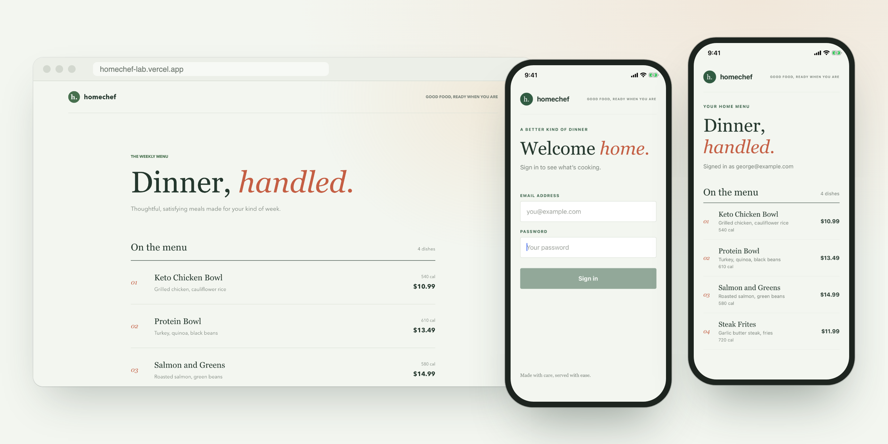
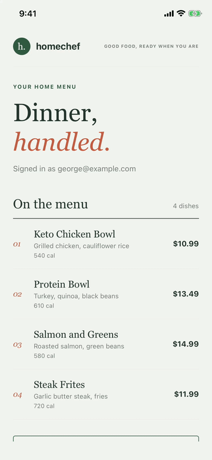

# homechef-lab

A small meal-kit app built across the stack: a Rails API, a React web menu, and an Expo React Native app.

Built over a weekend while ramping up on Rails.



<p align="center"></p>

## Live

- API and server-rendered menu: https://homechef-lab-gdrag-5772e4ad85f4.herokuapp.com
- React web menu: https://homechef-lab.vercel.app

Demo login, live and after `db:seed`: `demo@example.com` / `homechef-demo`

## What's in it

**Rails 8.1 API** (`app/`)

- Meals, customers, orders and order items in PostgreSQL, with model validations backed by database constraints
- Order items snapshot the meal price at purchase time
- Paginated order history with scopes, a tie-breaker sort and eager loading (no N+1)
- An index on `orders.delivery_date`, measured with `EXPLAIN ANALYZE`
- Menu cached with `Rails.cache`, invalidated in `after_commit`
- An idempotent background job for order confirmations
- Session auth for web pages (the Rails 8 generator) and token auth for the API, behind a shared `Api::BaseController`
- RSpec request, model and job specs

**React web** (`web/`): Vite, fetching the public menu over CORS. Deployed to Vercel.

**React Native** (`mobile/`): Expo with Expo Router, protected routes, a session context, tokens in SecureStore, Reanimated, and a Plop generator for new components and screens.

## Run it locally

Requires Ruby 3.4, Node, and Docker.

```bash
docker run -d --name homechef-lab-db -e POSTGRES_PASSWORD=postgres -p 127.0.0.1:5433:5432 postgres:17
bundle install
bin/rails db:prepare db:seed
bin/rails server
```

Web:

```bash
cd web && npm install && npm run dev
```

Mobile (iOS simulator, dev build):

```bash
cd mobile && npm install
npx expo run:ios          # first time, or after adding native code
npm start                 # API at localhost:3000
npm run start:prod        # API on Heroku
npm run new               # generate a component or screen
```

## Tests

```bash
bundle exec rspec
bin/rubocop
cd mobile && npm run lint
```
